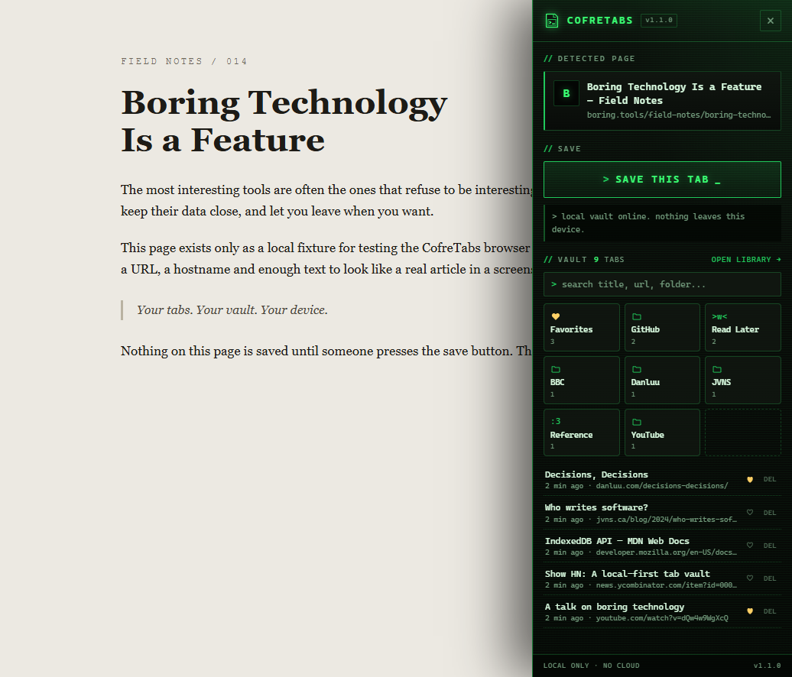
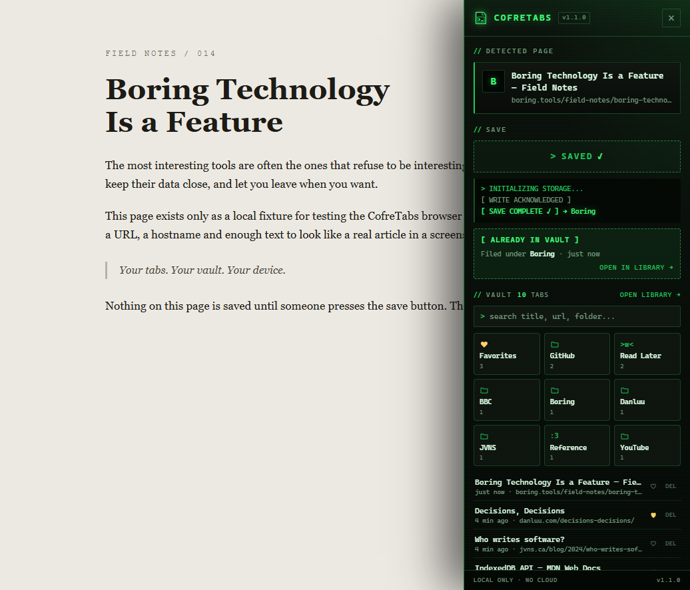
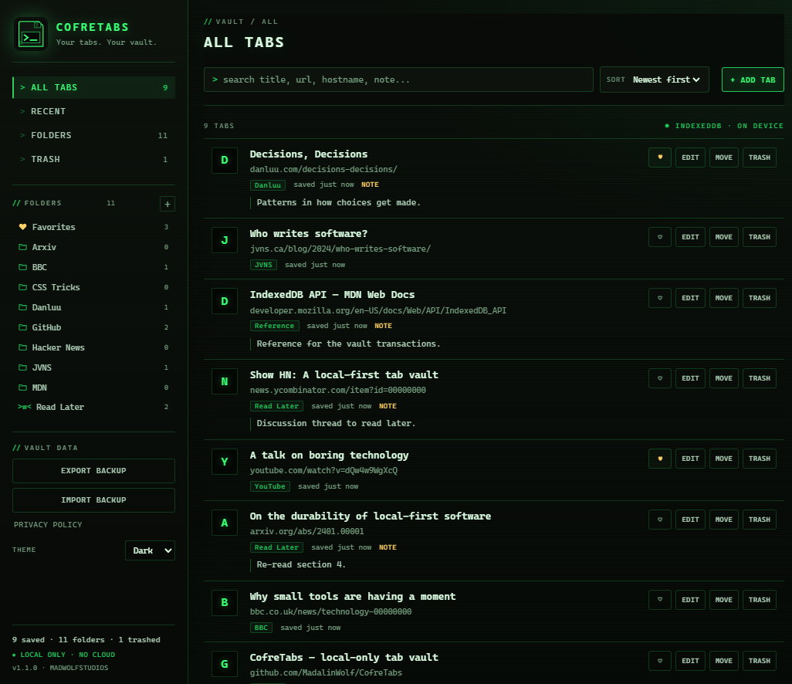
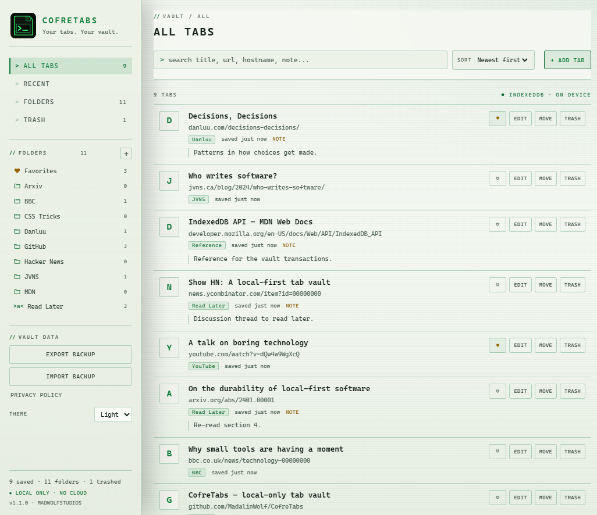
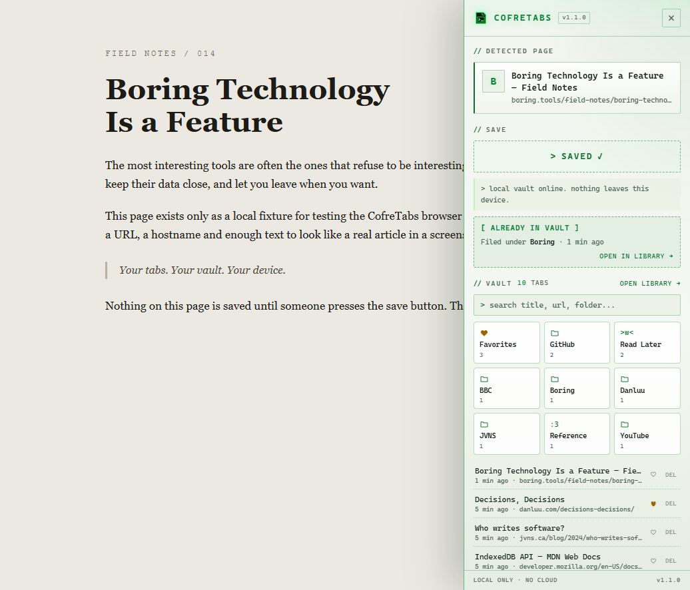
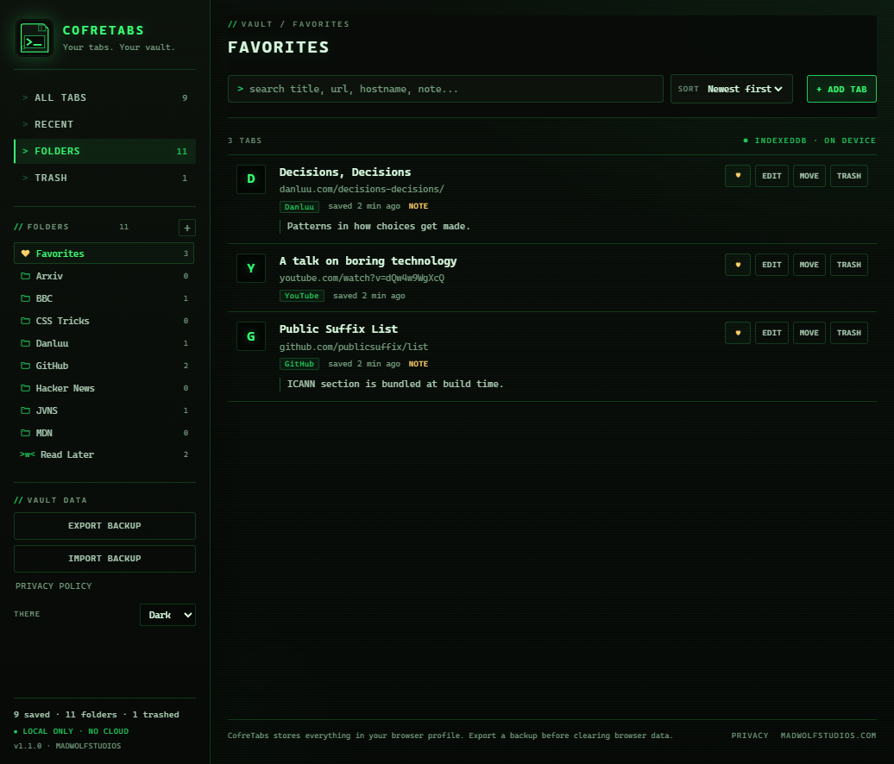
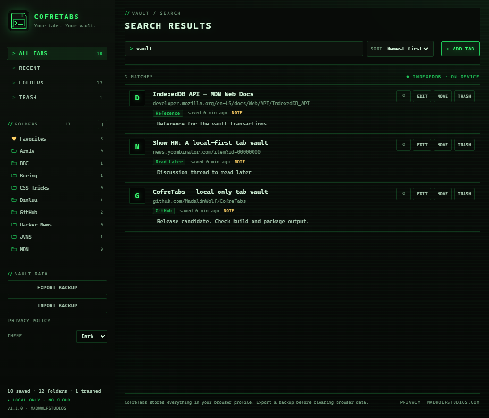
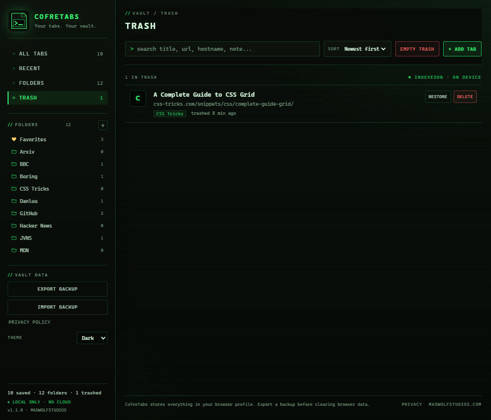
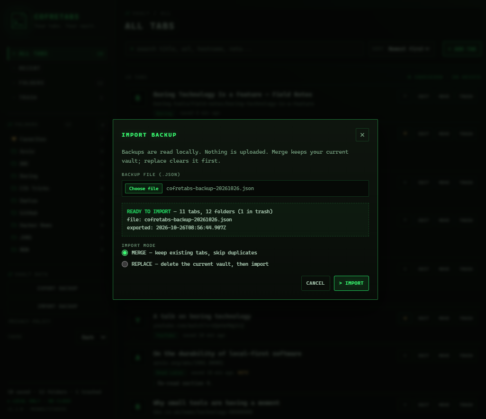

```text
 ____        __         _____     _
/ ___| ___  / _|_ __ __|_   _|_ _| |__  ___
| |   / _ \| |_| '__/ _ \| |/ _` | '_ \/ __|
| |__| (_) |  _| | |  __/| | (_| | |_) \__ \
 \____\___/|_| |_|  \___||_|\__,_|_.__/|___/

  Your tabs. Your vault. Your device.
  [ local only ]  [ no accounts ]  [ no cloud ]
```

# CofreTabs

CofreTabs is a Manifest V3 browser extension that turns the tab you're reading into a permanent, searchable entry in a private local vault. It's built for people who hoard "read later" tabs, research sessions, documentation, and rabbit holes — without handing their browsing collection to a bookmark service.

Everything lives in IndexedDB inside your browser profile. There is no backend, account, or cloud sync.

---

**💾 LOCAL FIRST** · **👤 NO ACCOUNTS** · **☁️ NO CLOUD** · **🚫 NO TRACKING** · **📡 NO TELEMETRY**

<p align="center"><strong>Built independently by <a href="https://madwolfstudios.com/">MadWolf Studios 🐺</a></strong></p>

---

## 🚀 Get CofreTabs

### 📥 Downloads

| Platform | Availability | Get it |
|:--|:--|:--|
| 🌐 Chrome Web Store | Not submitted or published | Coming soon |
| 🟦 Microsoft Edge Add-ons | Not published | Coming soon |
| 🦊 Firefox Add-ons | Not listed | Coming soon |
| 🔴 Opera Add-ons | Not listed | Coming soon |
| 🦁 Brave Browser | Manual installation | [Installation instructions](#-installation) |
| 💾 GitHub Releases | ✅ v1.1.0 Published | [View Release & Downloads](https://github.com/MadalinWolf/CofreTabs/releases/latest) |

**Current version:** `1.1.0`

**Browser compatibility:** Chrome 102+, Microsoft Edge 102+, Brave, Vivaldi, and Opera (Chromium-based browsers supporting Manifest V3).

*Browser compatibility does not mean the extension is available in each browser's official add-on store.*

---

---

## ❤️ Support Independent Development

CofreTabs is an independent project from **MadWolf Studios**. If it helps tame your tab collection, sharing the project, starring the repository, or supporting future development makes a difference.

| Support | Link |
|:--|:--|
| ⭐ Star the project | [GitHub Repository](https://github.com/MadalinWolf/CofreTabs) |
| 🐺 Follow the studio | [MadalinWolf on GitHub](https://github.com/MadalinWolf) |
| ❤️ GitHub Sponsors | [Support MadWolf Studios](https://github.com/sponsors/MadalinWolf) |
| ☕ Ko-fi | Coming soon |
| 🎮 itch.io | Coming soon |
| 🛍️ Gumroad | Coming soon |

### 🐱 Help feed the Studio Cat

The Studio Cat has no understanding of software licensing, database integrity, or release engineering.

The Studio Cat does understand snacks.

Your support helps keep independent development, testing, documentation, and future improvements going.

*GitHub Sponsors is the configured support destination listed here. Ko-fi, itch.io, and Gumroad are planned, not active payment links.*

<!-- TODO: ADD DONATION LINK -->
---

## 🔗 Official Links

- 🐺 **Studio:** [MadWolf Studios](https://madwolfstudios.com/)
- 💻 **Source code:** [GitHub Repository](https://github.com/MadalinWolf/CofreTabs)
- 📦 **Releases:** [GitHub Releases](https://github.com/MadalinWolf/CofreTabs/releases)
- 📝 **Privacy policy:** [`docs/PRIVACY.md`](docs/PRIVACY.md)
- 🛠️ **Contributing:** [`CONTRIBUTING.md`](CONTRIBUTING.md)
- 🔐 **Security reporting:** [`SECURITY.md`](SECURITY.md)
- 📋 **Store preparation:** [`docs/STORE.md`](docs/STORE.md) · [`docs/STORE-LISTING.md`](docs/STORE-LISTING.md)

---

## 🖥️ Take a Look Inside

The screenshots below were captured from the real v1.1.0 build in Chrome, using the actual panel and library code with a local fixture page and demo data. No personal browsing data is shown. See [`docs/screenshots/README.md`](docs/screenshots/README.md) for capture details.

### The save panel

Review the current page — title, host, automatic folder and the 3×3 folder grid — before deciding whether to save it.



### Save confirmed

The success state appears after the local database confirms the write.



### The library — dark theme

Favorites, custom folders, saved tabs with notes, MOVE controls and the theme switch.



### The library — light theme

The same vault in the light theme — the switch persists across launches and defaults to your system preference.



### The panel in the light theme



### Favorites

Heart any saved tab to collect it in the Favorites view — favoriting is a tag, the tab stays in its folder.



### Search

Search matches title, URL, hostname, folder and notes.



### Trash

Restore a trashed tab, delete it forever, or empty the Trash.



### Backup import

The import dialog validates the whole file and previews it before you choose merge or replace mode.



> The original v1.0.0 captures are kept alongside these in [`docs/screenshots/`](docs/screenshots/) (`panel.png`, `panel-saved.png`, `library.png`).

---

## ⚡ The 30-second version

1. Build and load the unpacked extension using the instructions below.
2. Browse to a normal `http(s)` page.
3. Click the CofreTabs toolbar icon.
4. Review the page details and press **SAVE THIS TAB**.
5. Open the library to search, organize, edit, restore, or back up your collection.

> **No automatic saving.** Clicking the toolbar icon opens the panel; it does not save the page. The vault is written only after you explicitly press the save button. Success is shown only after IndexedDB confirms the write.

---

## 🐺 Why CofreTabs Exists

We've all done it.

You open a tab to read later. Then another. Then a documentation page, a project reference, an article, a tutorial, and something that looked interesting at 2 a.m.

Eventually, your browser becomes an archaeological site of unfinished intentions.

Bookmarks can help, but sometimes you want something more focused: a private, searchable place to collect the pages you're actually interested in keeping.

CofreTabs was built for that.

It gives you a dedicated vault for saved tabs, with automatic domain-based organization, search, folders, favorites, notes, Trash, and portable backups — without requiring an account or a cloud vault.

### The idea is simple

💾 **Your data stays local.** Your saved collection lives in IndexedDB inside your browser profile.

🖱️ **You decide what gets saved.** Opening the panel is separate from the explicit save action.

📁 **Your tabs stay organized.** CofreTabs classifies domains automatically and lets you create your own folders.

🔍 **You can find things again.** Search titles, URLs, hostnames, folders, and notes.

🔒 **Privacy comes first.** The extension requests only `activeTab` and `scripting`, with no declared host permissions or automatically running content scripts.

🖥️ **The interface has personality.** A retro terminal-inspired design, phosphor-green accents, and honest status messages, with keyboard and reduced-motion considerations.

CofreTabs isn't trying to become another cloud platform. It's a small, focused tool for keeping track of the things you want to read, research, or revisit.

---

## ✨ Features

CofreTabs is designed to keep tab saving straightforward, predictable, and private.

### 💾 Explicit Saving

A sliding panel on the right side of the page — approximately 20% of the viewport width — shows the page title, hostname, automatic folder, and duplicate status before you commit.

Press **SAVE THIS TAB** when you're ready.

The progress state follows the actual database write. A failed write is reported as a failure, never as a success. Double-clicks and concurrent saves are rejected with a clear message.

### 📁 Automatic Domain-Based Folders

CofreTabs uses a bundled ICANN Public Suffix List to classify domains sensibly.

For example, `news.bbc.co.uk` is filed under **BBC**, not `co.uk`, while the original hostname remains attached to the saved tab.

Domain handling includes `www` prefixes, deep subdomains, IPv4 and IPv6 literals, malformed URLs, and shared hosting domains.

**PSL detail:** Private Public Suffix List rules are intentionally excluded. As a result, shared hosting domains such as `github.io` group by the platform.

### 🔍 Searchable Library

Search by **page title · URL · hostname · folder · notes**.

Sort by **newest · oldest · title · domain · folder**. Filter by folder or Trash.

Folders can be renamed. Deleting a folder moves its active tabs to Trash instead of silently destroying them.

### 🗑️ Trash and Recovery

Move entries to Trash, restore them, or permanently delete them from Trash.

When a tab is restored, it returns to its original folder if that folder still exists. Otherwise, it is re-filed by domain.

Permanent deletion is available only from Trash and requires confirmation.

### ❤️ Favorites

Heart any saved tab to collect it in the built-in **Favorites** view.

Favorites are available in both the library and the panel. Favoriting does not move or duplicate an entry: the tab stays in its existing folder and receives a favorite flag.

The built-in Favorites folder cannot be deleted.

### 📂 Custom Folders

Create folders, rename them, and move saved tabs into them using the inline **MOVE** selector.

Deleting a custom folder is safe: its active tabs go to Trash instead of being destroyed.

### 🌙 Light and Dark Themes

Switch themes from the library sidebar. The selected theme applies to both the library and the panel and persists across launches.

Until you choose a theme, CofreTabs defaults to your system preference.

### 🧩 Compact Folder Grid

The panel displays up to nine folders in a **3×3 grid**, with icons, names, and counts.

When there are more folders, up/down controls move through the grid one row at a time.

### 📝 Editable Titles and Notes

Give saved pages useful context. Edit a noisy page title, add a note explaining why you saved something, or move an entry into another folder.

### 📦 Portable JSON Backups

Export active and trashed entries into a versioned JSON backup.

Import supports **merge** and **replace** modes, validates the entire file before writing, and reports duplicate and invalid entry counts.

Malformed files are rejected before any data is written. Newer, unknown schema versions are refused with an upgrade message.

Backups are created locally and do not leave your machine unless you move the exported file yourself.

See [`docs/BACKUP-FORMAT.md`](docs/BACKUP-FORMAT.md) for the format specification.

### 🖥️ Retro Terminal Interface

A high-contrast, phosphor-green terminal-inspired interface — designed to feel like a small utility from a friendlier version of the 1990s.

The interface is scanline-free, keyboard-friendly, and aware of reduced-motion preferences. Status messages use accessible ARIA announcements instead of decorative confetti.

### 🖼️ No Remote Assets

Icons, CSS, and the Public Suffix List are bundled with the extension.

Saved favicons are retained only when the browser supplies an inline `data:image/*` payload. Otherwise, the interface draws a monogram.

CofreTabs does not fetch remote favicon URLs.

### 🔐 Minimal Permissions

CofreTabs requests only:

`activeTab` · `scripting`

It does not declare `tabs`, `history`, or `bookmarks` permissions. It requests no host permissions and has no automatically running content scripts.

See [Why these permissions?](#-privacy) for the explanation of each permission.

---

## 📥 Installation

CofreTabs supports Chromium-based browsers with Manifest V3: **Chrome 102+ · Edge 102+ · Brave · Vivaldi · Opera**.

### Requirements

- Node.js 20+ (tested on Node 24)
- npm
- A Chromium-based browser for loading and manual checks

### 1. Get the source

Clone or download the repository:

```sh
git clone https://github.com/MadalinWolf/CofreTabs.git
cd CofreTabs
```

Alternatively, download the repository ZIP from GitHub and extract it.

### 2. Build the extension

On Windows PowerShell:

```powershell
npm.cmd install
npm.cmd run build
```

On macOS or Linux:

```sh
npm install
npm run build
```

The build creates `dist/`, a validated copy of the runtime files. No bundler is involved.

If you prefer not to run Node.js, the repository root can also be loaded, but `dist/` is the supported build artifact.

### 3. Load it in your browser

**Chrome:** open `chrome://extensions`  
**Edge:** open `edge://extensions`  
**Brave:** open `brave://extensions`

Then:

1. Enable **Developer mode**.
2. Select **Load unpacked**.
3. Choose the `dist/` folder.
4. Pin CofreTabs to the toolbar.

### 4. Start saving

Open a normal web page and click the CofreTabs toolbar icon.

On restricted browser pages — such as `chrome://` pages, the Web Store, and PDF viewers — Chromium may block panel injection. CofreTabs opens the library instead and explains why the page could not be read. Nothing is saved automatically there either.

> **Windows note:** PowerShell may block the `npm.ps1` script because of the execution policy. Use `npm.cmd` as shown above.

---

## 🧭 Using CofreTabs

### Save the current tab

Click the toolbar icon. The panel shows the page title and hostname, the detected automatic folder, a warning if the exact URL is already active in the vault, and the **SAVE THIS TAB** button.

Press it once. The button enters a progress state while the write is in flight.

- **Success:** the panel confirms the save and offers **OPEN LIBRARY**.
- **Failure:** the panel reports the failure; it does not pretend the save succeeded.
- **Repeated clicks:** double-clicks and concurrent saves are rejected with a clear message.

A second toolbar click closes an already-open panel.

### Use the library

Open the library from the panel, the extension's details page, or the extension's own library page.

From there, you can search and sort the vault, open saved URLs, edit titles and notes, move tabs between folders, use Trash and recovery, add a URL manually if a page could not be injected, and export or import a backup.

### Backup format

Exports use:

- `format: "cofretabs-backup"`
- `schemaVersion: 1`

The file is plain UTF-8 JSON and includes folders, active tabs, and trashed tabs.

Import is **all-or-nothing**: a malformed file is rejected before anything is written. Newer, unknown schema versions are refused with an upgrade message.

See [`docs/BACKUP-FORMAT.md`](docs/BACKUP-FORMAT.md).

### Keyboard and accessibility

`Escape` closes the panel or an open dialog. Focus moves into the panel or dialog and returns when it closes.

Status messages use a polite live region; errors use an assertive one. Animations respect `prefers-reduced-motion: reduce`, and the save flow skips the decorative delay when reduced motion is requested.

---

## 🔒 Privacy

CofreTabs is designed around a local vault.

- **Storage:** saved tabs, folders, and notes live in IndexedDB in your browser profile.
- **Accounts:** no account or cloud vault is required.
- **Analytics:** no analytics or telemetry system is included in the documented extension design.
- **Remote assets:** the panel stylesheet, icons, and Public Suffix List are bundled with the extension.
- **Favicons:** no remote favicon URL is fetched; only an inline `data:image/*` favicon supplied by the browser may be retained.
- **Backups:** exports are created locally and downloaded by the browser.
- **Removal:** uninstalling the extension or clearing its extension data removes the local vault, so export a backup first if you want to keep your collection.

The extension's permissions are limited to `activeTab` and `scripting`; it declares no host permissions and no content scripts that run automatically.

Read the full policy in [`docs/PRIVACY.md`](docs/PRIVACY.md). A copy is also bundled at `src/library/privacy.html`.

### Why these permissions?

| Permission | Why it is needed |
|:--|:--|
| `activeTab` | Read the current tab's title and URL after you click the toolbar icon. |
| `scripting` | Inject the slide-over panel into the tab after you click. |

That's the declared permission list. The service worker uses the browser's tab API in response to toolbar clicks or panel interactions.

---

## 📦 Release Status

**Version in the source manifest and package metadata: `1.1.0`.**

| Item | Status |
|:--|:--|
| Source repository | ✅ Public |
| Current version | `1.1.0` |
| Chrome Web Store | Not published |
| Microsoft Edge Add-ons | Not published |
| Firefox Add-ons | Not listed |
| Opera Add-ons | Not listed |
| GitHub Releases | ✅ [CofreTabs v1.1.0 — View release](https://github.com/MadalinWolf/CofreTabs/releases/tag/v1.1.0) |

Store listing copy and submission preparation are documented in [`docs/STORE.md`](docs/STORE.md) and [`docs/STORE-LISTING.md`](docs/STORE-LISTING.md).

---

## ❓ FAQ

**Does CofreTabs sync between devices?**  
No. Use JSON export/import to move a vault manually.

**Does it save pages automatically?**  
No. Not on installation, toolbar click, or navigation. Only the explicit save button writes a tab record.

**Can it save `chrome://` pages?**  
No. Chromium blocks injection on restricted pages. CofreTabs opens the library with an explanation and a manual-add option for valid `http(s)` URLs.

**Why is my `github.io` site filed under GitHub Pages?**  
Only the ICANN section of the Public Suffix List is bundled. Private suffix rules are deliberately excluded, so shared platforms group together.

**What happens if I delete a folder?**  
Its active tabs move to Trash and lose their folder reference. Restoring a tab re-files it by domain if the folder no longer exists. Permanent deletion is available only from Trash and requires confirmation.

**Where is my data?**  
In IndexedDB inside your browser profile. There is no cloud copy. Export a backup before uninstalling or clearing extension data.

**Does the badge number include Trash?**  
No. It counts active entries only, capped visually at `999+`.

**Is favicon data sent anywhere?**  
CofreTabs does not fetch remote favicon URLs. It retains only inline `data:image/*` favicons supplied by the browser.

**Why can't I find CofreTabs in my browser's extension store?**  
The store listings are not currently published. Use the manual installation instructions until an official listing becomes available.

---

## 🛠️ Development

### Requirements

Node.js 20+ (tested on Node 24), npm, and a Chromium browser for manual checks.

On Windows PowerShell, `npm` may be blocked by the execution policy. Use `npm.cmd` or call Node directly.

### Commands

```powershell
npm.cmd install
npm.cmd test             # Run all unit and DOM tests
npm.cmd run test:verbose # Detailed test reporter
npm.cmd run build        # Validate and copy into dist/
npm.cmd run package      # Build and create a release ZIP + SHA-256
npm.cmd run icons        # Regenerate PNG icons from the pixel grid
npm.cmd run psl          # Refresh the bundled ICANN PSL snapshot
```

On macOS and Linux, use `npm` in place of `npm.cmd`.

### Project layout

```text
manifest.json              Manifest V3 entry point
src/background/             Service worker: toolbar, messages, badge
src/content/panel.js        Self-contained slide-over panel
src/library/                Library UI and bundled privacy page
src/storage/vault.js        IndexedDB vault, search, Trash, import/export
src/lib/                    URL/domain, PSL data, sanitisation, backup, format
src/styles/                 Terminal panel and library CSS
assets/icons/               Logo, favicon, and generated PNG icons
scripts/                    Build, package, ZIP, PSL, and icon tooling
tests/                      node:test suites
docs/                       Architecture, privacy, QA, store, backup, release docs
website/                    Static landing-page package
```

### Tests

The test suites use `fake-indexeddb` and `jsdom` to exercise the storage code and panel script without a real browser.

Run:

```sh
npm test
```

Coverage includes Public Suffix List/domain classification, URL normalization, schema validation, merge/replace import, Trash and folder deletion, duplicate handling, manual add, XSS-safe rendering, no-auto-save behavior, double-click rejection, truthful success/failure states, and accessible panel close handling.

A manual browser pass is still required for things jsdom cannot verify, including real toolbar injection, browser storage quotas, downloads, and visual rendering.

Use [`docs/QA-CHECKLIST.md`](docs/QA-CHECKLIST.md). The GitHub Actions workflow is located at `.github/workflows/ci.yml`.

### Build integrity checks

`scripts/build.mjs` checks the extension before building. Among other things, the build fails if:

- The manifest requests forbidden permissions or host permissions.
- An icon is missing or has the wrong pixel size.
- HTML contains inline scripts or event-handler attributes.
- Runtime code uses `eval`, `new Function`, `innerHTML =`, `document.write`, `chrome.storage`, or a remote `fetch`.
- A referenced file or ES module is missing.
- The build would write outside the repository.

Release ZIPs are created by a dependency-free ZIP implementation and verified by reading the archive back before the SHA-256 is reported.

---

## 🤝 Contributing

Bug reports, accessibility fixes, and focused pull requests are welcome.

Before contributing, read [`CONTRIBUTING.md`](CONTRIBUTING.md) and [`CODE_OF_CONDUCT.md`](CODE_OF_CONDUCT.md).

For security issues, follow [`SECURITY.md`](SECURITY.md) instead of opening a public issue.

---

## 📜 License

MIT © 2026 Mad Wolf Studios. See [`LICENSE`](LICENSE).

Third-party notices: [`docs/THIRD-PARTY.md`](docs/THIRD-PARTY.md).

---

```console
┌─[ MADWOLF STUDIOS ]────────────────────────────────────────────────┐
│                                                                    │
│   Thanks for using CofreTabs.                                      │
│                                                                    │
│   If this saved your tab sanity:                                   │
│     ★ star the project  → github.com/MadalinWolf/CofreTabs         │
│     → follow the studio → github.com/MadalinWolf                  │
│     ♥ support the work  → github.com/sponsors/MadalinWolf          │
│                                                                    │
│   Your tabs. Your vault. Your device.                              │
│   More experiments: https://madwolfstudios.com/                    │
│                                                                    │
└────────────────────────────────────────────────────────────────────┘
```
```
