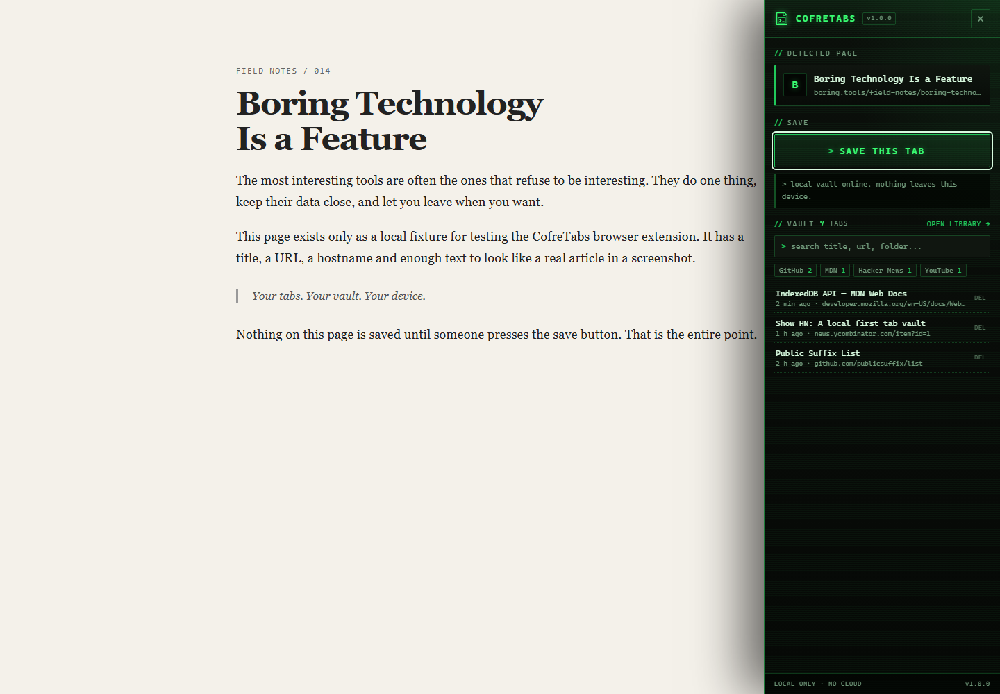
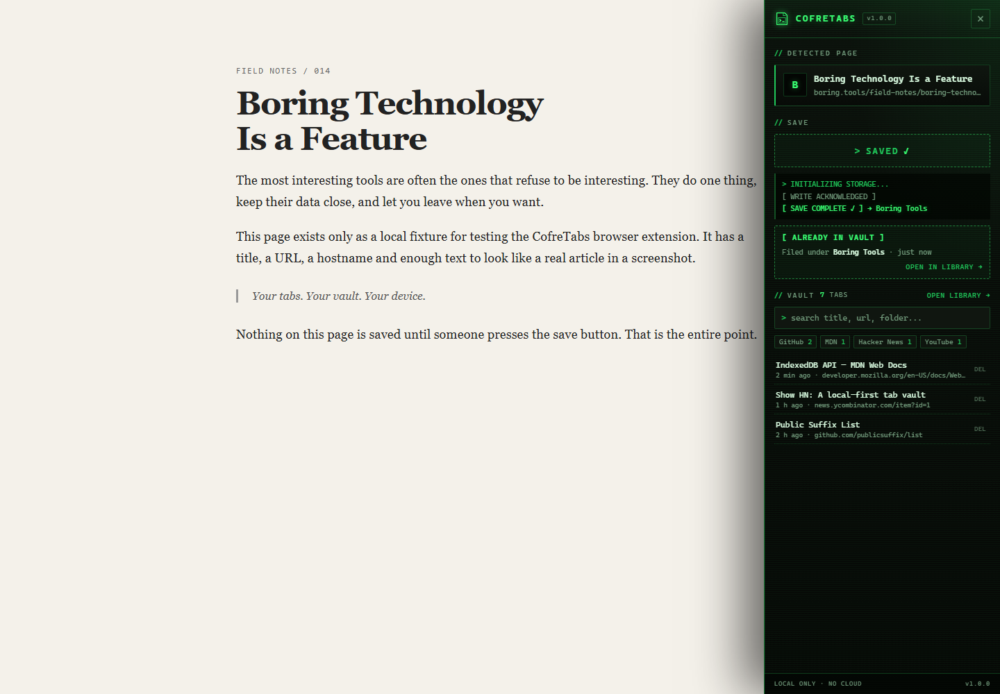
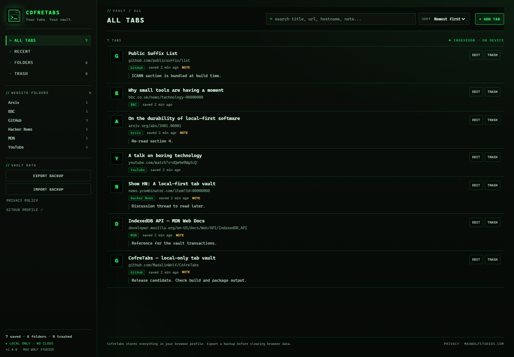

```text
  ____        __         _____     _       
 / ___| ___  / _|_ __ __|_   _|_ _| |__  ___
| |   / _ \| |_| '__/ _ \| |/ _` | '_ \/ __|
| |__| (_) |  _| | |  __/| | (_| | |_) \__ \
 \____\___/|_| |_|  \___||_|\__,_|_.__/|___/

  Your tabs. Your vault. Your device.
  [ local only ]  [ no accounts ]  [ no cloud ]
```

# CofreTabs

CofreTabs is a Manifest V3 browser extension that turns the tab you are reading
into a permanent, searchable entry in a private local vault. It is built for
people who hoard "read later" tabs, research sessions and rabbit holes — without
handing their browsing history to a bookmark service.

Everything lives in IndexedDB inside your browser profile. There is no backend,
no account, no sync, no analytics and no remote code.

> **Project status:** v1.0.0 source is complete and tested locally. It has **not**
> been published to the Chrome Web Store or to GitHub yet. See
> [Release status](#release-status).

---

## The 30-second version

1. Load the unpacked extension (instructions below).
2. Browse to any normal `http(s)` page.
3. Click the CofreTabs icon.
4. Read what will be saved, then press **SAVE THIS TAB**.
5. Open the library to search, organise, restore from Trash or back up.

CofreTabs **never saves a page automatically**. The panel does not write to the
vault until you press the save button, and the success state only appears after
IndexedDB has confirmed the write.

---

## Features

- **Explicit, honest saving.** A sliding panel on the right (~20% of the
  viewport) shows the title, host, automatic folder and duplicate status before
  you commit. The progress animation is tied to the real database write, not a
  timer; a failed write is shown as a failure, never as success.
- **Automatic folders from the real domain.** The bundled ICANN Public Suffix
  List keeps `news.bbc.co.uk` under **BBC**, not under `co.uk`, while preserving
  the original hostname on every saved tab. `www`, deep subdomains, IPv4/IPv6
  literals and malformed URLs are handled. Shared hosting domains such as
  `github.io` intentionally group by the platform because private PSL rules are
  excluded.
- **A library that stays usable at scale.** Search title, URL, hostname, folder
  and notes. Sort by newest, oldest, title, domain or folder. Filter by folder or
  Trash. Folders can be renamed; deleting a folder moves its tabs to Trash rather
  than silently destroying them.
- **Trash with a way back.** Move entries to Trash, restore them, or permanently
  delete them from Trash. Restored tabs return to their original folder when it
  still exists; otherwise they are re-filed by domain.
- **Editable notes and titles.** Add context to a tab, fix a noisy page title or
  move it to another folder.
- **Portable JSON backups.** Export active and trashed entries with a versioned
  schema. Import supports **merge** and **replace**, validates the entire file
  before writing, and reports duplicate/invalid counts. Backups never leave your
  machine unless you move the file yourself.
- **Retro terminal interface.** Scanline-free, reduced-motion-aware, keyboard
  friendly, high-contrast phosphor green, with honest ARIA announcements instead
  of confetti.
- **No remote assets.** Icons, CSS and the Public Suffix List are bundled. Saved
  favicons are only kept when the browser supplies an inline `data:image/*`
  payload; otherwise the UI draws a monogram. CofreTabs makes no network request
  for a favicon.
- **Minimal permissions.** `activeTab` and `scripting` only. No `tabs`, no
  `history`, no `bookmarks`, no host permissions, no background network access.

---

## Screenshots

These were rendered in Chrome from the real panel/library code using a local
fixture page and demo data. No personal browsing data is shown.
[`docs/screenshots/README.md`](docs/screenshots/README.md) documents how they
were captured.

**The save panel** — review first, then press the button:



**After the write is acknowledged** — success is shown only after the local
database confirms:



**The library** — search, folders, notes and Trash:



---

## Install (unpacked, developer mode)

CofreTabs supports Chromium-based browsers with Manifest V3 (Chrome 102+,
Edge 102+, Brave, Vivaldi, Opera).

### Chrome / Edge / Brave

1. Download or clone this repository.
2. Build the loadable folder:

   ```sh
   npm.cmd install       # Windows PowerShell
   # or: npm install      # macOS / Linux
   npm.cmd run build
   ```

   No bundler is involved: `dist/` is a validated copy of the runtime files.
   If you prefer not to run Node, you can load the repository root instead,
   but `dist/` is the supported artefact.

3. Open `chrome://extensions` (or `edge://extensions`, `brave://extensions`).
4. Enable **Developer mode**.
5. Choose **Load unpacked** and select the `dist` folder.
6. Pin CofreTabs to the toolbar.

The toolbar icon opens the panel on the current page. A second click closes it.
On browser-internal pages (`chrome://`, the Web Store, PDF viewers and other
restricted URLs) the extension opens the library instead and explains why the
page could not be read. Nothing is saved automatically there either.

---

## Using CofreTabs

### Save the current tab

Click the toolbar icon. The panel shows:

- the page title and hostname;
- the detected automatic folder;
- a warning if the exact URL is already active in the vault;
- a **SAVE THIS TAB** button.

Press it once. The button enters a progress state while the write is in flight.
Double-clicks and concurrent saves are rejected with a clear message. On success
the panel shows the folder and offers **OPEN LIBRARY**. On failure it says the
save failed and keeps the page untouched.

### Library

Open the library from the panel, the extension's details page, or
`chrome-extension://<id>/src/library/library.html`. From there you can:

- search and sort the vault;
- open a saved URL;
- edit a title or note;
- move a tab between folders;
- move tabs to Trash, restore them, or delete permanently from Trash;
- add a URL manually if a page could not be injected;
- export a backup, or import one in merge/replace mode.

### Backup format

Exports use `format: "cofretabs-backup"` and `schemaVersion: 1`. The file is
plain UTF-8 JSON and includes folders, active tabs and trashed tabs. Import is
all-or-nothing: a malformed file is rejected before anything is written.
Newer, unknown schema versions are refused with an upgrade message. See
[`docs/BACKUP-FORMAT.md`](docs/BACKUP-FORMAT.md).

### Keyboard and accessibility

- `Escape` closes the panel or an open dialog.
- Focus is moved into the panel/dialog and returned on close.
- Status messages use a polite live region; errors use an assertive one.
- Animations respect `prefers-reduced-motion: reduce`, and the save flow then
  skips the decorative delay entirely.

---

## Privacy

CofreTabs is local-first by construction:

- saved tabs, folders and notes live in IndexedDB in your browser profile;
- there are no accounts, servers, telemetry, ads or third-party scripts;
- the extension makes **no runtime network requests**; the panel stylesheet is
  loaded from the extension package itself;
- no remote favicon URLs are stored or fetched;
- exports are created locally and downloaded by the browser;
- removing the extension or clearing extension data removes the vault.

The full policy is in [`docs/PRIVACY.md`](docs/PRIVACY.md) and is also bundled at
`src/library/privacy.html`.

### Why these permissions?

| Permission | Why it is needed |
| --- | --- |
| `activeTab` | Read the current tab's title/URL only after you click the toolbar icon. |
| `scripting` | Inject the slide-over panel into that tab when you click. |

That is the complete permission list. There are no host permissions and no
content scripts declared to run automatically. The service worker uses the
browser's own tab API only in response to a toolbar click or panel interaction.

---

## Development

Requirements: Node.js 20+ (tested on Node 24), npm, and a Chromium browser for
manual checks. `npm` on Windows PowerShell may be blocked by execution policy;
use `npm.cmd` or call `node` directly.

```sh
npm.cmd install
npm.cmd test             # node --test (all unit + DOM tests)
npm.cmd run test:verbose # spec reporter
npm.cmd run build        # validate + copy into dist/
npm.cmd run package      # build + release/CofreTabs-v1.0.0.zip + SHA-256
npm.cmd run icons        # regenerate PNG icons from the pixel grid
npm.cmd run psl          # refresh the bundled ICANN PSL snapshot
```

### Project layout

```text
manifest.json              Manifest V3 entry point
src/background/            service worker: toolbar, messages, badge
src/content/panel.js       self-contained slide-over panel (classic script)
src/library/               library UI and bundled privacy page
src/storage/vault.js       IndexedDB vault, search, trash, import/export
src/lib/                   URL/domain, PSL data, sanitisation, backup, format
src/styles/                terminal panel and library CSS
assets/icons/              logo, favicon and generated PNG icons
scripts/                   build, package, zero-dependency ZIP, PSL, icons
tests/                     node:test suites (domain, storage, backup, panel)
docs/                      architecture, privacy, QA, store, backup, release notes
website/                   static landing page package (not deployed)
```

### Tests

The suites run against `fake-indexeddb` and `jsdom`, so they exercise the real
storage code and the real panel script without a browser:

```sh
node --test
```

Coverage highlights: PSL/domain classification, URL normalisation, schema
validation, merge/replace import, trash and folder deletion, duplicate handling,
manual add, XSS-safe rendering, no-auto-save behaviour, double-click rejection,
truthful success/failure states, and accessible panel close handling.

A manual browser pass is still required for things jsdom cannot verify: real
toolbar injection, browser storage quotas, downloads and visual rendering. Use
[`docs/QA-CHECKLIST.md`](docs/QA-CHECKLIST.md).

### Build integrity checks

`scripts/build.mjs` fails the build if, among other things:

- the manifest requests forbidden permissions or host permissions;
- an icon is missing or the wrong pixel size;
- HTML contains inline scripts or event-handler attributes;
- runtime code uses `eval`, `new Function`, `innerHTML =`, `document.write`,
  `chrome.storage`, or a remote `fetch`;
- a referenced file or ES module is missing;
- the build would land outside the repository.

Release ZIPs are written by a dependency-free ZIP implementation and verified
by reading the archive back before the SHA-256 is reported.

---

## Release status

Honest status as of the v1.0.0 working tree:

- **Source, tests, build and release packaging:** complete locally.
- **GitHub repository:** prepared locally, **not published**. No GitHub
  authentication/CLI was available in the build environment. Creating the public
  repository and pushing is a manual owner action.
- **Chrome Web Store:** **not submitted and not published**. Store listing copy
  and a submission checklist are prepared in [`docs/STORE.md`](docs/STORE.md)
  and [`docs/STORE-LISTING.md`](docs/STORE-LISTING.md).
- **Website:** a static package is prepared in [`website/`](website/) but **not
  deployed**.
- **Donation link:** not yet configured. Search the repository for
  `TODO: ADD DONATION LINK`; the verified URL must be supplied by the owner.

Do not treat any URL in this repository as a live download unless the owner has
published it. No release ZIP is hosted by the project yet.

---

## FAQ

**Does CofreTabs sync between devices?**
No. Use JSON export/import to move a vault manually.

**Does it save pages automatically?**
No. Not on install, not on toolbar click, not on navigation. Only the explicit
save button writes a tab record.

**Can it save `chrome://` pages?**
No. Chromium blocks injection there. CofreTabs opens the library with an
explanation and a manual-add option for valid `http(s)` URLs.

**Why is my `github.io` site filed under GitHub Pages?**
Only the ICANN section of the Public Suffix List is bundled. Private suffix
rules are deliberately excluded so shared platforms group together.

**What happens if I delete a folder?**
Its active tabs move to Trash and lose their folder reference. Restoring a tab
re-files it by domain if the folder no longer exists. Permanent deletion is only
possible from Trash, with confirmation.

**Where is my data?**
In IndexedDB inside your browser profile. There is no cloud copy. Export a
backup before uninstalling or clearing extension data.

**Does the badge number include Trash?**
No. It counts active entries only, capped visually at `999+`.

**Is favicon data sent anywhere?**
No. Only inline `data:image/*` favicons supplied by the browser are stored. No
remote URL is fetched.

---

## Contributing

Bug reports, accessibility fixes and focused pull requests are welcome. Read
[`CONTRIBUTING.md`](CONTRIBUTING.md) and the
[`CODE_OF_CONDUCT.md`](CODE_OF_CONDUCT.md) first. Security issues should follow
[`SECURITY.md`](SECURITY.md), not public issues.

## License

MIT © 2026 Mad Wolf Studios. See [`LICENSE`](LICENSE).
Third-party notices: [`docs/THIRD-PARTY.md`](docs/THIRD-PARTY.md).

---

```console
┌─[ MAD WOLF STUDIOS ]────────────────────────────────────────────┐
│                                                                  │
│   Thanks for using CofreTabs.                                    │
│                                                                  │
│   If this saved your tab sanity:                                 │
│     ★ star the repository      → github.com/MadalinWolf          │
│     → follow the studio        → github.com/MadalinWolf          │
│     ♥ donate                   → TODO: ADD DONATION LINK         │
│                                                                  │
│   More experiments: https://madwolfstudios.com/                  │
│                                                                  │
└──────────────────────────────────────────────────────────────────┘
```

The donation line is intentionally marked `TODO: ADD DONATION LINK`. No payment
URL has been invented; the project owner should replace it with a verified link
before publishing.
